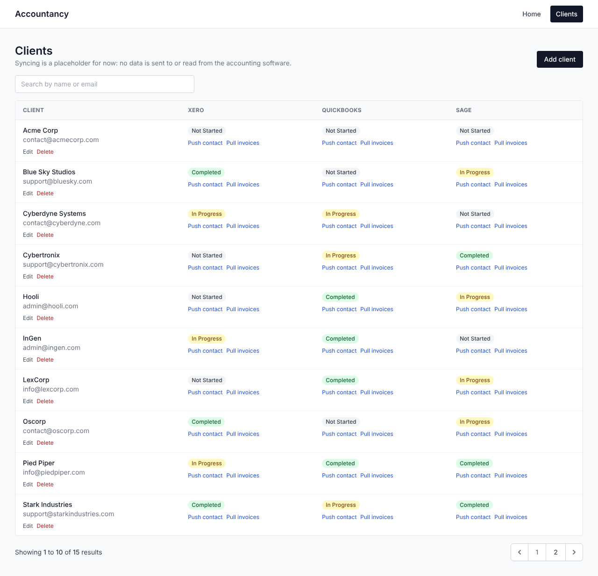

# Accountancy

An early-stage web app for accountancy practices to track their clients and the status of each client's sync with accounting software: **Xero**, **QuickBooks** and **Sage**.

It's built with [Laravel 11](https://laravel.com) and [Livewire 3](https://livewire.laravel.com), and the app lives in the [`Accountancy/`](Accountancy) directory.

## What it does

The app is a prototype: syncing with the accounting software is a placeholder, so nothing is sent to or read from Xero, QuickBooks or Sage yet. So far it has:

- **Client list** (`/clients`, `App\Livewire\Clientlist`): your clients with a sync status for each of Xero, QuickBooks and Sage (`Not Started`, `In Progress`, `Completed` or `Failed`). It can be searched by name or email and shows 10 clients per page.
- **Add, edit and delete clients** (`/clients/create`, `/clients/{id}/edit`, `App\Livewire\ClientForm`). Each client needs a name and a unique email.
- **Push contact**: sends a client to the accounting software as a contact. For now it always succeeds and marks that service `Completed`.
- **Pull invoices**: fetches a client's invoices and outstanding balance. For now it returns made-up figures, which are shown under the status.

- **Login**: every page needs you to be logged in. There's no sign-up page; accounts are created with `php artisan app:create-user`. After 5 wrong passwords for an email, login is locked for a minute.

Clients are stored in the `clients` table. Each client has one row per service in `client_syncs`, holding the status, the last pulled invoice count and balance, and when it was last synced.


- **Homepage** (`/`, `App\Livewire\Homepage`) and a collapsible **navigation bar** (`App\Livewire\NavigatorBar`).

## How syncing is wired

Each accounting service is a class that implements `App\Services\Accounting\AccountingProvider`, which has two methods: `pushContact()` and `pullFinancials()`. `config/accounting.php` lists the services and the class each one uses. All three use `PlaceholderProvider` for now. To build a real integration, write a class that implements the interface and point that service at it in the config.

## Project structure

```
Accountancy/
├── app/
│   ├── Console/Commands/      # CreateUser (app:create-user)
│   ├── Livewire/              # Clientlist, ClientForm, Login, Homepage, NavigatorBar, AppLayout
│   ├── Models/                # Client, ClientSync, User
│   └── Services/Accounting/   # AccountingProvider interface, PlaceholderProvider
├── config/accounting.php      # Which services exist and which class each uses
├── database/seeders/          # ClientSeeder: 15 sample clients
├── resources/views/livewire/  # Page layout and component views (Tailwind CSS)
├── routes/web.php             # / and /clients
└── tests/Feature/             # Page and sync tests
```

## Current limitations

- Push contact and Pull invoices are placeholders (see above).
- It's built for one user: there are no teams, roles or per-user client lists.
- There's no "forgot password" page. To reset a password, create a new account with `app:create-user` (or change it with `php artisan tinker`).

## Requirements

- PHP 8.2 or later
- Composer
- Node.js and npm (to build the CSS and JavaScript)
- SQLite (the default database in `.env.example`)

## Getting started

```bash
cd Accountancy
composer install
npm install
npm run build
cp .env.example .env
php artisan key:generate
touch database/database.sqlite
php artisan migrate --seed   # --seed adds the 15 sample clients
php artisan app:create-user  # asks for your name, email and password
php artisan serve
```

Then open http://127.0.0.1:8000 and log in. Run the tests with `php artisan test`.

## Tech stack

| Component | Version |
|-----------|---------|
| PHP | ^8.2 |
| Laravel | ^11.9 |
| Livewire | ^3.5 |
| Tailwind CSS | ^3.4 |
| PHPUnit | ^11.0 |

## License

MIT, as declared in `composer.json`.
